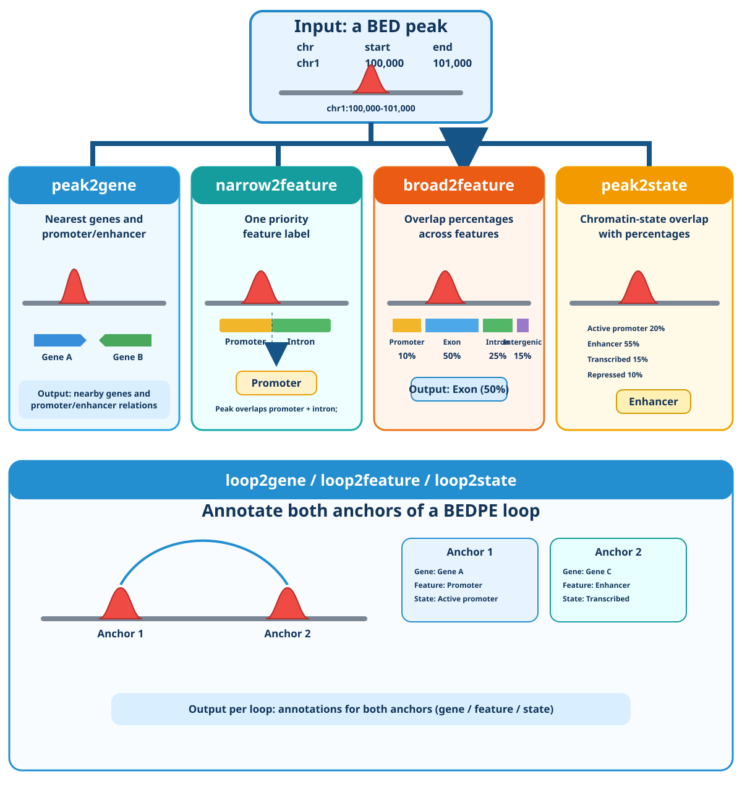

# sjcab_peak2anno

`sjcab_peak2anno` annotates genomic peaks to genes, genomic features, and
chromatin states. It provides the `peak2anno` and `sjcab-peak2anno` command
line interfaces.




## Documentation

Read the full documentation at
[sjcab-peak2anno.readthedocs.io](https://sjcab-peak2anno.readthedocs.io/).

- [Installation](https://github.com/stjudecab/sjcab_peak2anno/blob/master/docs/install.md)
- [Configuration](https://github.com/stjudecab/sjcab_peak2anno/blob/master/docs/configuration.md)
- [Commands](https://github.com/stjudecab/sjcab_peak2anno/blob/master/docs/commands.md)
- [Input and output](https://github.com/stjudecab/sjcab_peak2anno/blob/master/docs/input-output.md)
- [Python API](https://github.com/stjudecab/sjcab_peak2anno/blob/master/docs/api.md)
- [Changelog](https://github.com/stjudecab/sjcab_peak2anno/blob/master/docs/changelog.md)

## Install

Pip version does not require `bedtools`; `auto` uses the Python interval
backend. To use native bedtools and create a reviewable script, set
`SJCAB_PEAK2ANNO_BACKEND=bedtools` with bedtools available in `PATH`.
The generated `bedtools-peak2anno.sh` supports mode `1` (one wide window) and
mode `2` (promoter-first, enhancer-second).

```bash
pip install sjcab_peak2anno
```

The conda package does not require external interval tools.

```bash
conda install stjudecab::sjcab_peak2anno
```

## Quick start
```bash
# it would automatic sjcab_peak2anno_db install hg38 v31 and annotate peaks.bed
wget https://github.com/stjudecab/sjcab_peak2anno/raw/refs/heads/master/tests_data/peaks.bed
peak2anno peak2gene peaks.bed
```

## Command examples

Annotate a BED peak to nearby genes. Omitting `-o` writes the table to stdout:

```bash
peak2anno peak2gene tests_data/peaks.bed \
  --tss-bed tests_data/tss.bed \
  --prom-enha-cutoffs 2000,50k
```

Example output (tab-delimited):

```text
chr1  50  150  peak1  GeneA  ENSGA  .  .  GeneA  ENSGA  0
```

Run multiple annotations in one table with the combined command syntax using
default hg38 v31:

```bash
peak2anno peak2gene narrow2feature tests_data/peaks.bed \
  --workers 2 -o combined.tsv
```

Representative combined output columns look like this:

```text
chr  start  end  peak  Closest_Gene  FeatureAssignment
chr1 100000 101000 peak1 GeneA        Promoter
```

Annotate both anchors of a BEDPE loop with `loop2gene`, `loop2feature`, or
`loop2state`:

```bash
peak2anno loop2gene loops.bedpe --tss-bed annotations/hg38/tss.bed -o loops.tsv
```

Representative loop output contains separate anchor columns:

```text
chr1 100000 101000 chr1 200000 201000 anchor1_Closest_Gene anchor2_Closest_Gene
chr1 100000 101000 chr1 200000 201000 GeneA                 GeneC
```

### Loop operations

Loop files use BEDPE coordinates: columns 1--3 are the source anchor and
columns 4--6 are the target anchor. The operations `inter1d`, `inter`, and
`merge` write `bedpe`, `txt` (with a header), or `txtnohead` output.

```bash
# Intersect either selected anchor with a BED file
peak2anno inter1d -i tests_data/loops.bedpe -b tests_data/loop_regions.bed \
  --direction source -f txt

# Same direction: source-source and target-target
peak2anno inter -i tests_data/loops.bedpe -b tests_data/loops_reverse.bedpe \
  --direction direction -f bedpe -o same-direction.bedpe

# Reverse direction: source-target and target-source
peak2anno inter -i tests_data/loops.bedpe -b tests_data/loops_reverse.bedpe \
  --direction reverse -f txtnohead -o reverse-direction.txt

# Merge source anchors while retaining every loop's original target anchor
peak2anno merge -i tests_data/loops.bedpe --direction source \
  -f bedpe -o merged-source.bedpe
```

For example, source merging turns two overlapping source anchors into two
rows with the same merged source while retaining their separate targets:

```text
chr1  0  15  chr1  100 110  A
chr1  0  15  chr1  105 115  B
```

The included fixtures `tests_data/loops.bedpe`,
`tests_data/loops_direction.bedpe`, and `tests_data/loops_reverse.bedpe` can
be used to test same-direction, reverse-direction, and one-anchor merge
behavior. Use `peak2anno <command> --help` to see all defaults.
